# Hybrid SOC Lab — Microsoft Sentinel + Azure Arc + Entra ID

**Part 6 of a home lab series** — see [MyHomeLab](https://github.com/TannerHollaway/MyHomeLab).

## Overview

This project extends my on-prem Active Directory lab (`holl.domain`) into Microsoft's cloud security stack. I ship endpoint and identity telemetry into **Microsoft Sentinel**, re-run the **same attack chain from [Part 5](https://github.com/TannerHollaway/Settinup-Up-Splunk-and-Simulating-attacks)** (recon, Kerberoasting, privilege creep, PsExec lateral movement), and detect it in **KQL**.

**The headline:** the same attacks detected in two SIEMs — **Splunk SPL vs Sentinel KQL, side by side**

### Skills demonstrated
- Microsoft Sentinel (Defender portal) — scheduled analytics rules, entity mapping, incidents, automation rules
- KQL detection engineering mapped to MITRE ATT&CK
- Dual-SIEM comparison — the same detections in Splunk SPL and Sentinel KQL
- Azure Arc onboarding of on-prem servers
- Azure Monitor Agent (AMA) + Data Collection Rules (DCR)
- SOAR — Logic App playbook for automated IP enrichment.

---

## Lab Environment

| Host | Role | IP | Telemetry |
|---|---|---|---|
| DC01 | Domain Controller + DNS (Windows Server 2022) | 10.10.10.10 | Security, Sysmon → Splunk + Sentinel |
| FS01 | File Server (Windows Server 2022) | 10.10.10.20 | Security, Sysmon → Splunk + Sentinel |
| CLIENT01 | Workstation (Windows 11 VM) | DHCP (VLAN 10) | Security, Sysmon → Splunk + Sentinel |
| siem | Splunk Enterprise (Ubuntu) — from Part 5 | 10.10.10.30 | Receiver |
| KALI | Attacker (Impacket, hashcat) | 10.10.10.117 and .164 (multi-homed) | — |

**Domain:** `holl.domain` (NetBIOS `HOLL`) — VLAN 10, `10.10.10.0/24`
**Cloud tenant:** `holldomain.onmicrosoft.com`
**Sentinel workspace:** `law-holl-sentinel` in resource group `rg-holl-sentinel` (region: Central US)

---

## Part 0 — Planning & Architecture

### Architecture
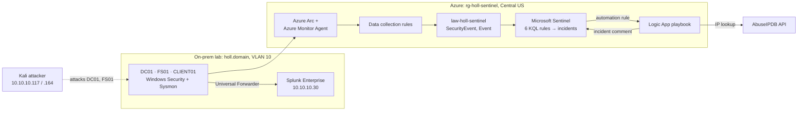
*The same Windows Security and Sysmon events go to both SIEMs: to Splunk through the Universal Forwarder, and to Sentinel through Azure Arc and the Azure Monitor Agent.*

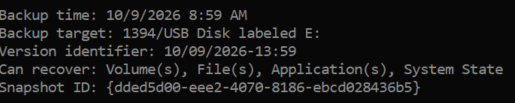
*DC01 is physical, so instead of a VM snapshot its Active Directory state is protected with a `wbadmin` system state backup — `wbadmin get versions` confirms System State is recoverable.*

### Trial & licensing clocks

| Item | Route | Start date | Expires / cancel-by |
|---|---|---|---|
| Microsoft 365 Business Standard (creates tenant) | Business trial | 2026-10-09 | |
| Azure subscription | Azure free account ($200 / 30 days) | 2026-10-09 | 2026-11-08 |
| Sentinel free trial (31 days, 10 GB/day) | New Log Analytics workspace `law-holl-sentinel` | 2026-10-09 | ~2026-11-09 |

### Detections to port (from Part 5)

| Part 5 alert (SPL) | ATT&CK | Primary source | Sentinel status |
|---|---|---|---|
| Brute Force - Excessive Failed Logons | T1110 | 4625 | ✅ rule built (Part 3), fired on re-run |
| Kerberoasting - RC4 Service Ticket Request | T1558.003 | 4769 `0x17` | ✅ rule built (Part 3), fired on re-run |
| Account Manipulation - Privileged Group Modification | T1098 | 4728/4732/4756 | ✅ rule built (Part 3), fired on re-run |
| Tier0 Logon Attempt on Workstation | T1078.002 | 4625 `0xC000015B` | ✅ rule built (Part 3), fired on re-run |
| Account Discovery - Anomalous NTLM Authentication | T1087 | 4624 Type 3 NTLM | ✅ rule built (Part 3), fired on re-run |
| Lateral Movement - Executable Dropped to C:\Windows | T1021.002 | Sysmon 11 | ✅ rule built (Part 3), fired on re-run |

### Design decisions
- **Defender portal, not Azure portal.** Microsoft is retiring Sentinel in the Azure portal (March 31, 2027), and new workspaces are onboarded to the Defender portal automatically. Building here reflects how SOCs will operate Sentinel going forward.
- **Dual-ship to Splunk and Sentinel.** Splunk stays running so each attack lands in both SIEMs at the same moment, which makes the SPL-vs-KQL comparison exact.
- **Same ATT&CK IDs and alert names as Part 5**, so the comparison table lines up one-to-one.
- **No E5 — Sysmon carries endpoint telemetry.** Microsoft 365 E5 isn't offered as a public trial, and Defender for Endpoint's raw `Device*` tables require Plan 2. The core of this project doesn't need them: all six Part 5 detections run on Windows Security and Sysmon events, which reach Sentinel through Azure Arc + the Azure Monitor Agent with only an Azure subscription. Entra sign-in logs (requires Entra ID P1) are an optional add-on.
- **Defender for Identity excluded — hardware constraint.** Microsoft requires at least 2 cores and 6 GB of RAM on the domain controller for the sensor. DC01 (physical, Intel N3540, 4.6 GB RAM, not upgradeable) falls below that. Running the sensor unsupported risks silent gaps: a missed detection would be indistinguishable from a starved sensor. Identity coverage comes from DC Security events (4768/4769/4728/4625) via Sentinel instead. The Part 5 LDAP-recon visibility gap remains open and is documented as such.
### Pre-build troubleshooting

| # | Symptom | Cause | Resolution |
|---|---|---|---|
| 1 | CLIENT01 missing from VirtualBox Manager | Original VM lost or corrupted | Restored from an existing VirtualBox clone. Verified before trusting it: hostname, `Test-ComputerSecureChannel` = True (machine account password still valid with the DC), `gpresult` showing the correct OU and all five GPOs applied, Sysmon running. |
| 2 | Restored CLIENT01 had no Splunk forwarder | Clone predated the Part 5 forwarder install | Reinstalled the Universal Forwarder pointing at `10.10.10.30:9997` with the Part 5 `inputs.conf`. |
| 3 | After reinstall, only Security reached Splunk — no Sysmon | Installer defaulted to a virtual service account; the Sysmon log only grants read to SYSTEM/Administrators (same issue as Part 5) | Set the `SplunkForwarder` service to log on as Local System and restarted it. Verified both sources in `index=windows`. |
| 4 | Defender portal listed two workspaces named `law-holl-sentinel` after a typo'd resource group was deleted and recreated | Deleting the resource group removed the Azure resources, but the Defender portal kept the old workspace connection | Disconnected the stale workspace in Defender portal Settings → Microsoft Sentinel → Workspaces; confirmed the remaining one (`rg-holl-sentinel`) is Primary and Connected. |

---

## Part 1 — Data Ingestion

**Result:** all three domain hosts ship their Security and Sysmon logs to Sentinel, while still forwarding to Splunk.

### What was built

| Component | Name | Purpose |
|---|---|---|
| Log Analytics workspace + Sentinel | `law-holl-sentinel` | Stores the logs; Sentinel adds SIEM features on top. Managed from the Defender portal. |
| Azure Arc (Connected Machine agent) | DC01, FS01, CLIENT01 | Registers on-prem machines in Azure so Azure can deploy agents to them |
| Azure Monitor Agent | Arc extension on all three | Ships logs to the workspace — the counterpart of the Splunk Universal Forwarder |
| Data collection rule | `dcr-holl-securityevents` | All Windows Security events → `SecurityEvent` table (via the Windows Security Events via AMA connector) |
| Data collection rule | `dcr-holl-sysmon` | XPath `Microsoft-Windows-Sysmon/Operational!*` → `Event` table |

A data collection rule is the cloud-managed equivalent of a Splunk `inputs.conf`: it defines what to collect, from which machines, and where to send it.

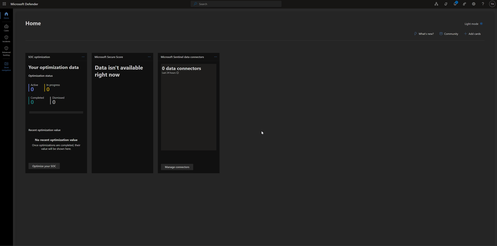
*The Sentinel workspace `law-holl-sentinel` under the `HollDomain.onmicrosoft.com` tenant — the empty "0 data connectors" Defender home before any data sources were added (the "before" state).*

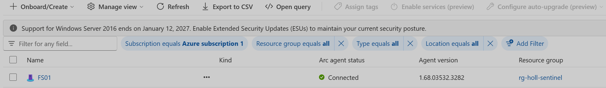
*FS01 showing Arc agent status **Connected** in `rg-holl-sentinel` — the Connected Machine agent projects the on-prem server into Azure so the Azure Monitor Agent can be deployed to it.*

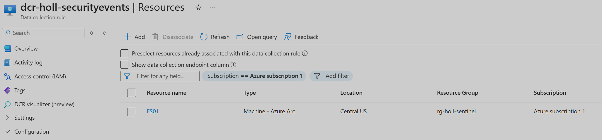
*The Windows Security Events data collection rule, scoped to the Arc-enabled machines in `rg-holl-sentinel`.*

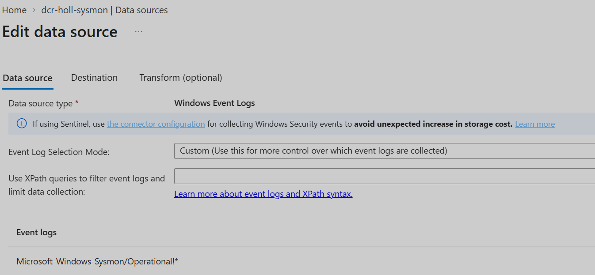
*The Sysmon data collection rule — Custom XPath `Microsoft-Windows-Sysmon/Operational!*` sending to the `Event` table.*

### Verification
```kql
search in (SecurityEvent, Event) TimeGenerated > ago(1h)
| summarize Events = count(), Latest = max(TimeGenerated) by $table, Computer
```
Returned rows for DC01, FS01, and CLIENT01 in both tables (2026-10-10). End-to-end proof: `whoami` commands run on FS01 appeared in Sentinel as Sysmon Event ID 1 with the full command line.

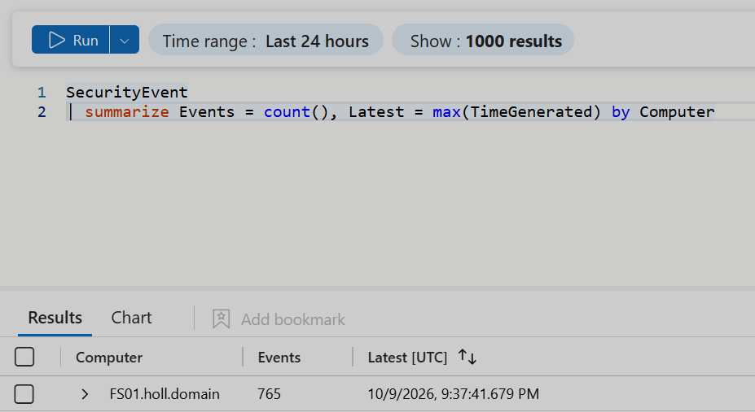
*First telemetry landing: FS01's Windows Security log in the `SecurityEvent` table.*

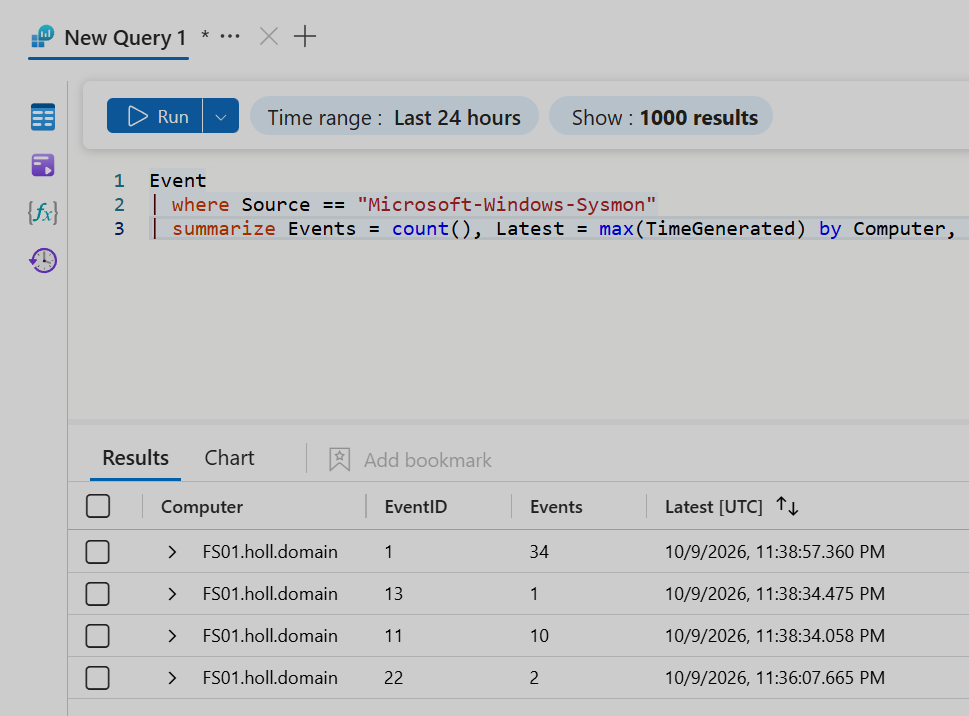
*FS01 Sysmon in the `Event` table, broken out by Event ID — including Event ID 11 (file create), the data the PsExec detection runs on.*

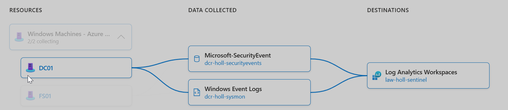
*The DCR visualizer: DC01, FS01, and CLIENT01 (3/3 collecting) flowing through both rules into `law-holl-sentinel`.*

### Design notes
- **Sysmon in its own table.** Sysmon goes to `Event`, kept separate from the Windows Security log in `SecurityEvent`.
- **CLIENT01 onboarded through Arc — a lab trade-off.** The Azure Monitor Agent's Windows client installer requires an Entra-joined device; CLIENT01 is joined only to on-prem AD. Microsoft supports Arc on Windows 10/11 in server-like environments, which an always-on lab VM fits. In production, workstations would be hybrid-joined and use the client installer.
- **Host naming differs between SIEMs.** Sentinel's `Computer` field holds the FQDN (`FS01.holl.domain`); Splunk's `host` holds the short name (`FS01`). Host filters must match each platform's format.

### Troubleshooting

| # | Symptom | Cause | Resolution |
|---|---|---|---|
| 5 | Sysmon rule created, agent had the rule, but nothing appeared in `WindowsEvent` or `Event` | The rule's **stream** was `Microsoft-SecurityEvent`, so Sysmon events were routed into the `SecurityEvent` table. The portal's Data source and Destination tabs looked correct — only the rule's JSON View showed the real routing. | Confirmed the Sysmon events in `SecurityEvent` (by `Channel`), deleted the rule, and rebuilt it through the Azure Monitor wizard. Verified the JSON showed `Microsoft-Event` before waiting for data. Earlier Sysmon rows remain in `SecurityEvent` and are excluded by filtering on `Channel`. |
| 6 | No workspace offered as a destination when building the rule | A data collection rule can only send to a workspace in its own region; the rule defaulted to a different region than the workspace (Central US) | Set the rule's region to Central US. |
| 7 | CLIENT01 stopped sending Heartbeat after a reboot, while Arc still showed Connected and the agent extension showed Succeeded | Arc's Guest Configuration Extension Service (`ExtensionService`), which launches the Azure Monitor Agent, timed out at boot (System 7000/7009, 30-second service start timeout) on the slow-booting VM (confirmed: the lab VMs boot slowly under load on the host). Arc's core service (`himds`) kept running, so Arc looked healthy. | Started `ExtensionService` manually; Heartbeat resumed. Lesson: "Arc Connected" ≠ "logs flowing" — Heartbeat is the real health signal. |

## Part 2 — Attack Chain Re-run

The six Part 5 attacks were re-run from Kali (and CLIENT01) and confirmed landing in **both** Splunk and Sentinel, matching on timestamp and key fields. Attacks were run in kill-chain order; privilege creep (#2) runs before the Kali attacks because Kerberoast and PsExec authenticate as the HR user it elevates.

| # | Attack | ATT&CK | Signal (both SIEMs) | UTC |
|---|---|---|---|---|
| 1 | Brute Force | T1110 | 4625 ×5 for `bruteforce_test` on DC01 | 22:58–23:00 |
| 2 | Privilege Creep | T1098 | 4728, ahernandez → Domain Admins, by Administrator | 18:29:31 |
| 3 | NTLM Recon (`GetADUsers`) | T1087 | 4624 LogonType 3, NTLM, ahernandez from Kali | 20:12:04 |
| 4 | Kerberoast (`GetUserSPNs`) | T1558.003 | 4769 svc_sql, EncType `0x17` (RC4) | 20:15:54 |
| 5 | PsExec to FS01 | T1021.002 | Sysmon 11, `.exe` dropped to `C:\Windows\` | 21:21:29 |
| 6 | Tier 0 Logon on CLIENT01 | T1078.002 | 4625 Status `0xC000015B` for jdoe-adm | 22:33:42 |


*Both SIEMs set to UTC: the same `whoami` on CLIENT01 reads `18:23:50.683` in Splunk and in Sentinel's `UtcTime` — identical to the millisecond, which is what makes the side-by-side comparison trustworthy.*


*#2 Privilege creep: `Administrator` adds ahernandez to Domain Admins — 4728 at `18:29:31.171` in both SIEMs.*


*#3 Recon: the authentication footprint of `GetADUsers` — 4624 LogonType 3, NTLM, ahernandez from the Kali IP.*


*#4 Kerberoast: 4769 for svc_sql with EncType `0x17` (RC4) against the AES-only domain. In Sentinel the encryption type had to be `extract()`-ed from the EventData XML; in Splunk it is a ready field.*


*#5 Lateral movement: an `.exe` dropped to `C:\Windows\` on FS01 (Sysmon Event ID 11), caught by behavior — the Windows-root location — not the random binary name.*


*#6 Tier 0 logon: jdoe-adm denied on CLIENT01 — 4625 Status `0xC000015B` (deny-GPO), distinct from the typo'd `joe-adm` attempts that logged `0xc000006d` (no such user).*


*#1 Brute force: a burst of failed logons against `bruteforce_test` on DC01, meeting the ≥5 threshold.*

### Findings surfaced during the re-run

- **Account identity mismatch.** The HR user's display name (`Alex Herrnandez`), logon name (`sAMAccountName`), and UPN (`ahernandez@holl.domain`) had three different spellings, so `Get-ADUser ahernandez` and the first Kali bind both failed while interactive login worked. Corrected the `sAMAccountName` to `ahernandez` for consistency with Part 5. A concrete case of "a matching name isn't a matching identity" — detections should key on SID/DN, not display strings.
- **Multi-homed attacker.** Kali has two VLAN-10 interfaces (10.10.10.117 and 10.10.10.164); Impacket used whichever the OS routed through, so IP-scoped queries must match both.
- **Defender stopped execution, not the drop — and a too-narrow search window nearly hid it.** Both PsExec drops were logged by Sysmon (Event ID 11): `ErqLhpbE.exe` from run 1 (Defender on) and `wIHYvJkZ.exe` from run 3 (Defender off), each written to `C:\Windows\` by `System`. Defender killed the remote shell on run 1, but the file-create still happened and was recorded. The first verification only surfaced run 3; a wider search the next day (while building the detection rule) found both. *Corrected finding:* an earlier version of this section concluded run 1 left no artifact — that was a search-scoping error, not a telemetry gap. The lesson is the one from Part 5's hunt: match the search window to the full incident span before treating an absence as real. Separately, service-install auditing (4697) is not enabled domain-wide, so the service-creation step of PsExec is not recorded in the Security log in either SIEM. *Backlog: enable Audit Security System Extension (4697), or collect System log 7045.*
- **Denied-logon precision.** Among the 4625s on CLIENT01, three were typo'd usernames (`joe-adm`, Status `0xc000006d` = no such user) and only the correctly-typed `jdoe-adm` produced `0xC000015B` (deny-GPO). Keying on the Status code, not the account name, isolates GPO-denied logons from fumbled passwords.

### SPL-vs-KQL differences found (feed Part 4)

- **Field parsing.** Splunk's Windows add-on pre-extracts fields like `TicketEncryptionType`; in Sentinel's `SecurityEvent`, some fields are promoted to columns while others (e.g. the 4769 encryption type) stay inside the `EventData` XML and must be pulled with `extract()`. Sysmon in the `Event` table keeps all details in `RenderedDescription` text.
- **Case sensitivity.** KQL `==` is case-sensitive, so `Status == "0xC000015B"` missed the stored lowercase `0xc000015b`; SPL matches case-insensitively by default. Use `=~` in KQL.
- **IP format.** 4769 logged the source as `::ffff:10.10.10.164` (IPv6-mapped IPv4) — match the embedded IPv4, don't assume a clean string.
- **Wildcard precision.** Splunk warns that `TargetFilename="C:\\Windows\\*.exe"` (mid-string wildcard) may be unreliable; KQL's anchored regex `@"C:\\Windows\\[^\\]+\.exe$"` expresses the "Windows root only" scope more precisely.

## Part 3 — Detection in KQL

All six Part 5 Splunk detections were rebuilt as **Sentinel scheduled analytics rules**, reusing the exact alert names and ATT&CK IDs so the Part 4 comparison lines up one-to-one. Each rule runs every 5 minutes over a 5-minute window — the same cadence as the Part 5 cron alerts. Each query was tested in Logs against the Part 2 attack data before the rule was created, then the whole chain was re-run so the rules fired on live activity and produced incidents.

### The six rules

| Rule (name = Part 5 name) | ATT&CK | Severity | Source | KQL notes |
|---|---|---|---|---|
| Brute Force - Excessive Failed Logons | T1110 | Medium* | 4625 | `summarize count() by TargetUserName`, threshold ≥5 |
| Kerberoasting - RC4 Service Ticket Request | T1558.003 | High | 4769 | encryption type parsed from `EventData` XML with `extract()` |
| Account Manipulation - Privileged Group Modification | T1098 | High | 4728/4732/4756 | all three group-scope event IDs |
| Tier0 Logon Attempt on Workstation | T1078.002 | High | 4625 `0xC000015B` | `Status =~` (case-insensitive) |
| Account Discovery - Anomalous NTLM Authentication | T1087 | Medium | 4624 Type 3 NTLM | excludes machine accounts and ANONYMOUS LOGON |
| Lateral Movement - Executable Dropped to C:\Windows | T1021.002 | High | Sysmon 11 | anchored regex, Windows root only, case-insensitive |

\* **T1110 lowered from High (Part 5) to Medium** — a handful of failed logons is the highest-base-rate false positive of the six (ordinary password fumbles), so it should sit below confirmed-malicious alerts in the queue. A password **spray** (few attempts across many accounts) or failures-followed-by-success would be higher-fidelity follow-up detections — noted as backlog.

Each rule maps query fields to **entities** (Account, Host, IP, File), which is what lets Sentinel correlate alerts and build incident graphs — a layer Splunk's triggered-alert list doesn't have. The rule queries are exported under [`kql/`](kql/).

### Result — the rules fired on a live attack chain

Re-running the full chain produced **10 alerts across all six rules** (T1087 fired four times, T1558.003 twice), which Sentinel raised as **10 incidents**. *Corrected count:* this section originally said 8 alerts / 9 incidents; the Part 6 investigation (Q1/Q2) found a tenth, a T1087 alert on FS01 from the PsExec NTLM logon, created at 17:40 UTC after the first count was taken. The PsExec drop (T1021.002) surfaced one run later than the rest — a reminder that an absent alert is often scheduling lag, not a failed rule; confirmed by checking the rule-run history rather than assuming.

### Finding — one attack, ten incidents (alert fatigue)

Every alert became its own incident, even though eight of the ten share the same account (ahernandez) or the same host (DC01). An analyst would face ten separate tickets for one intrusion. This is the alert-fatigue problem that the Part 5 correlation timeline solved by hand, and it motivates **alert grouping**: grouping repeat alerts from a single rule (by matching entities) collapses the duplicates. Grouping only operates *within* a rule, though — correlating *different* techniques into one incident is left to Defender's correlation engine, which did not link them here, or to the analyst during investigation (Part 6). Defender did auto-assign **priority scores** (Kerberoast 3, most 2, brute force 1), a built-in triage aid with no Splunk equivalent.

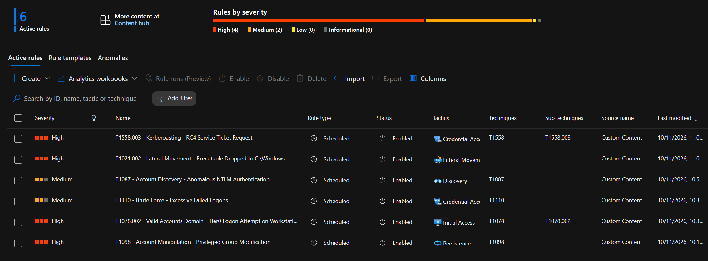
*The six custom scheduled rules — 4 High, 2 Medium — each mapped to its MITRE technique, mirroring the Part 5 Splunk alerts.*

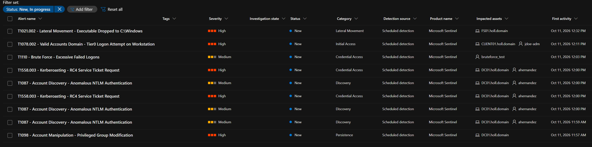
*Alerts from the live re-run: every one of the six detections fired, with the correct entities (ahernandez, jdoe-adm, bruteforce_test, DC01, CLIENT01, FS01).*

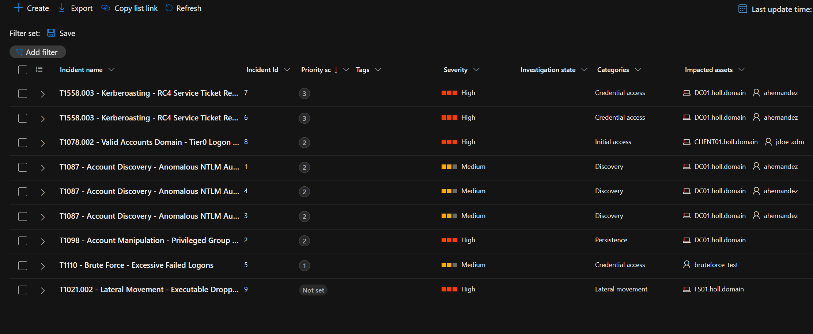
*One attack chain raised separate incidents (each 1/1) — the alert-fatigue case for alert grouping. Captured before the tenth (FS01 T1087) was created. Note Defender's per-incident priority scores.*

## Part 4 — SPL vs KQL

The same six detections, the same attack chain, two SIEMs. Splunk ran the unchanged Part 5 alerts; Sentinel ran the Part 3 rules. Both received the identical Windows Security and Sysmon events from the same three hosts.

### Results on the same run

| Detection | ATT&CK | Splunk alerted | Sentinel alerted |
|---|---|---|---|
| Privileged Group Modification | T1098 | ✅ | ✅ |
| Anomalous NTLM Authentication | T1087 | ✅ | ✅ |
| Kerberoasting - RC4 Service Ticket | T1558.003 | ✅ | ✅ |
| Executable Dropped to C:\Windows | T1021.002 | ✅ | ✅ |
| Tier0 Logon Attempt on Workstation | T1078.002 | ✅ | ✅ |
| Brute Force - Excessive Failed Logons | T1110 | ❌ | ✅ |

The Splunk server was powered off during the run. When it came back, the Universal Forwarders delivered the backlog (events indexed ~77 minutes after they occurred) and five of six Splunk alerts still fired. Brute force did not — see *Lookback windows* below.

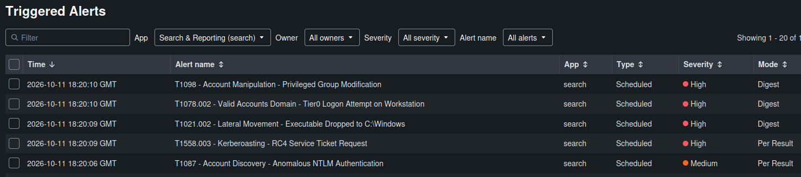
*Splunk's triggered alerts for the same chain, fired at 18:20 UTC as the backlog arrived — five of the six Part 5 detections.*

### SPL vs KQL, per detection

Every difference below was hit while building the Sentinel rules, not looked up.

**Privileged Group Modification (T1098)**
```spl
# SPL
index=windows (EventCode=4728 OR EventCode=4732 OR EventCode=4756)
| stats values(SubjectUserName) AS added_by, values(MemberName) AS member BY TargetUserName, EventCode
```
```kql
// KQL
SecurityEvent
| where EventID in (4728, 4732, 4756)
| project TimeGenerated, Computer, Group = TargetUserName, MemberAdded = MemberName, AddedBy = SubjectUserName, EventID
```
Closest match of the six — both read the fields as first-class columns.

**Kerberoasting (T1558.003) — the biggest gap**
```spl
# SPL — TicketEncryptionType is a ready-made field
index=windows EventCode=4769 TicketEncryptionType=0x17
```
```kql
// KQL — the same field is buried in EventData XML and must be parsed out
SecurityEvent
| where EventID == 4769
| extend EncType = extract(@'Name="TicketEncryptionType">([^<]+)', 1, EventData)
| where EncType =~ "0x17"
```
Splunk's Windows add-on pre-extracts 4769 fields; Sentinel's `SecurityEvent` leaves several inside the raw XML. Point to Splunk for out-of-the-box field coverage; point to KQL for having `extract()` / `parse` built into the language when you need it.

**Tier 0 Logon (T1078.002) — case sensitivity**
```spl
# SPL — case-insensitive by default
index=windows EventCode=4625 Status=0xC000015B
```
```kql
// KQL — == is case-sensitive; the value is stored lowercase, so == "0xC000015B" returns nothing
SecurityEvent | where EventID == 4625 and Status =~ "0xC000015B"
```

**Executable Dropped to C:\Windows (T1021.002) — matching precision**
```spl
# SPL — mid-string wildcard; Splunk warns it can be unreliable
index=windows EventCode=11 TargetFilename="C:\\Windows\\*.exe" TargetFilename!="C:\\Windows\\*\\*"
```
```kql
// KQL — one anchored regex says "Windows root, one filename, .exe", case-insensitive
Event | where Source == "Microsoft-Windows-Sysmon" and EventID == 11
| extend TargetFilename = extract(@'TargetFilename:\s*(\S+)', 1, RenderedDescription)
| where TargetFilename matches regex @"(?i)^C:\\Windows\\[^\\]+\.exe$"
```

### What each platform did better

| | Splunk / SPL | Sentinel / KQL |
|---|---|---|
| Field extraction | Add-ons pre-parse Windows fields — less query work | Some fields need `extract()` from XML / flat text |
| Case handling | Case-insensitive by default | `==` case-sensitive; use `=~` (a trap, but explicit) |
| Pattern matching | Wildcards, flagged as imprecise mid-string | Anchored regex — precise, self-documenting |
| Entities & incidents | Triggered-alert list; correlation done by hand | Alerts map to entities → auto-built incidents + priority score |
| IP format | plain `10.10.10.164` | `::ffff:10.10.10.164` — strip the prefix for the IP entity |

Overall: SPL got detections working with less parsing because the add-ons do the field work up front; KQL's stricter, more explicit syntax caught precision issues SPL glosses over, and Sentinel's entity/incident model is a layer SPL doesn't have.

### Finding — lookback window decides whether late data is detected

The one divergent result (brute force) came from alert *configuration*, not the query. Splunk's live alert settings turned out to vary per alert, and to differ from the Part 5 README:

| Splunk alert | Lookback window | Caught the 77-min-late backlog? |
|---|---|---|
| Kerberoasting | Last 24 hours | ✅ |
| Brute Force | Last 15 minutes | ❌ — events fell outside the window |

So Splunk survived its own downtime *only where the lookback was wide enough*. Sentinel's rules all use a 5-minute lookback and alerted in real time **because its cloud collection never stopped** — but the same tight window is a latent risk: if a Sentinel agent is offline for an hour (as CLIENT01's was one morning), its events would arrive outside the 5-minute window and never alert. *Tuning lesson for the Sentinel rules: widen the lookback (e.g. run every 5 min, look back 1 hour) and dedupe with alert grouping.* *(Note: the Part 5 repo documents these alerts as 5-minute windows; the live settings differ and that repo's README should be corrected.)*

The headline, in one line: **both SIEMs detected the same six-step intrusion from identical telemetry; the differences were in query ergonomics, the incident model, and how each handled late-arriving data — not in detection power.**

## Part 5 — Automation (SOAR)

One playbook, built to do the first thing a Tier 1 analyst does with an IP-bearing incident: look up the IP's reputation and record the result on the ticket.

### What was built

| Component | Name | Purpose |
|---|---|---|
| Logic App playbook | `pb-enrich-ip-abuseipdb` | Pulls IP entities from the incident, queries AbuseIPDB, writes the result as an incident comment |
| Automation rule | `ar-enrich-ip-abuseipdb` | Runs the playbook automatically when an incident is created by an IP-mapping rule |
| Identity | System-assigned managed identity | Granted **Microsoft Sentinel Responder** on the workspace (least privilege: can comment on incidents, can't change rules or data) |

**Flow:** `Microsoft Sentinel incident` trigger → `Entities - Get IPs` → **For each** IP: `HTTP` (GET `api.abuseipdb.com/api/v2/check`, `maxAgeInDays=90`) → `Compose` (builds the comment text) → `Add comment to incident (V3)`.

The automation rule targets the analytics rules whose incidents carry an IP entity: **T1558.003** and **T1087**. It also includes T1110, which maps only the account (see Troubleshooting #3).

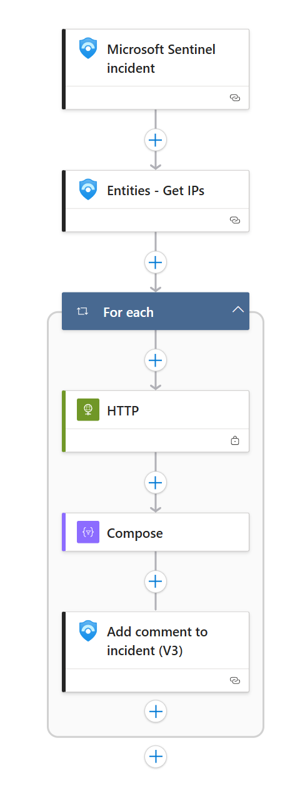
*The playbook: incident trigger, IP extraction, then a per-IP loop of lookup → format → comment. The padlock on the HTTP action means Secure inputs/outputs are on.*

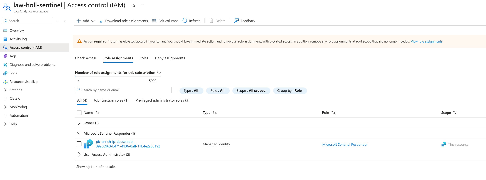
*The playbook's system-assigned managed identity holds **Microsoft Sentinel Responder** on `law-holl-sentinel`.*

### Secrets handling
- The AbuseIPDB API key sits in the HTTP action's `Key` header. **Secure inputs** and **Secure outputs** are enabled on that action, so run history hides the key and the raw response.
- The exported JSON in [`playbooks/`](playbooks/) has the key replaced with `<ABUSEIPDB_API_KEY>`, and subscription and tenant IDs with placeholders. *Production improvement: store the key in Azure Key Vault and read it with the managed identity, so it never lives in the workflow definition.*

### Result

Run manually against incident 7 (T1558.003 Kerberoasting), the playbook posted:

> AbuseIPDB enrichment - IP: 10.10.10.117 | Confidence: 0% | Reports (90d): 0 | Public IP: False

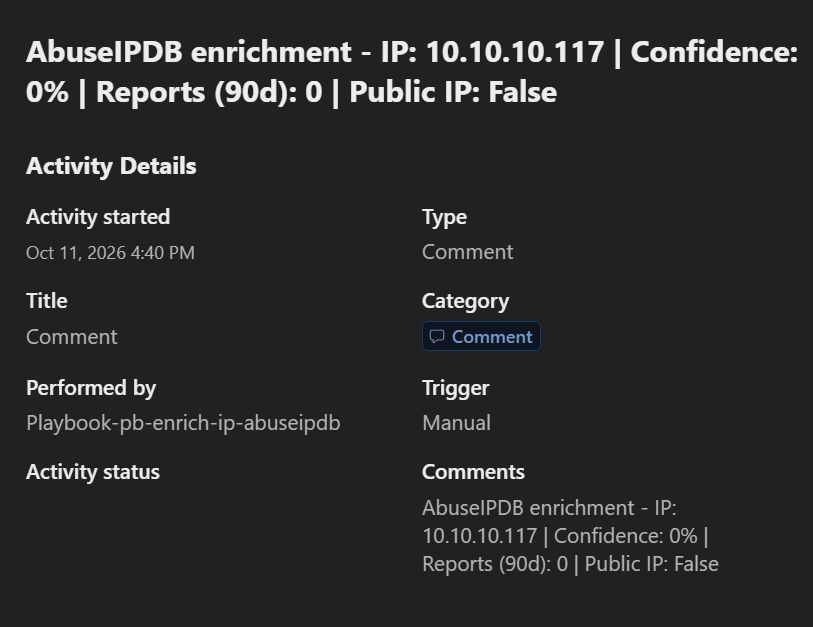
*The enrichment comment, posted by the playbook's identity.*

**Interpretation:** 10.10.10.117 is the lab attacker's private (RFC 1918) address, so AbuseIPDB has no history for it. `Public IP: False` says so outright. **"0% confidence" here means "no data," not "clean."** Microsoft's built-in entity reputation said the same thing (Unknown, 0/100). The playbook proves the pipeline end to end; the enrichment only becomes meaningful on public IPs. That's the honest limitation of reputation enrichment in an isolated lab, and a reminder that reputation never stands in for host evidence.

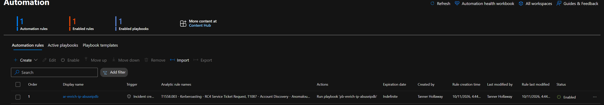
*The automation rule, enabled. Created after the manual test above; not yet observed firing on a new incident.*

### Troubleshooting

| # | Problem | Cause | Fix |
|---|---|---|---|
| 1 | The first runs showed **Succeeded**, but the incident comment was blank | The comment field on `Add comment to incident (V3)` is a rich-text editor. It accepted the inline `concat()` expression in the UI but saved only an empty paragraph (`<p><br></p>`), confirmed in the action's code view. An empty comment is a valid post, so the run still succeeded. | Moved the expression into a **Compose** action (plain input) and inserted Compose's **Outputs** token into the comment. Lesson: **a green run isn't a correct result**; check the output, not just the status. |
| 2 | Unsaved designer work lost | The browser crashed before **Save**; the designer keeps edits only in the open tab | Rebuilt the playbook and saved after each action. |
| 3 | Automation rule includes T1110, whose incidents carry no IP | T1110 was scoped in on the assumption that it mapped an IP; its rule maps only the Account entity ([`kql/T1110-brute-force.kql`](kql/T1110-brute-force.kql)). Caught in the final review. | Harmless: on a T1110 incident, `Entities - Get IPs` returns nothing and the loop runs zero times. Fix: remove T1110 from the rule's conditions. *Open.* |

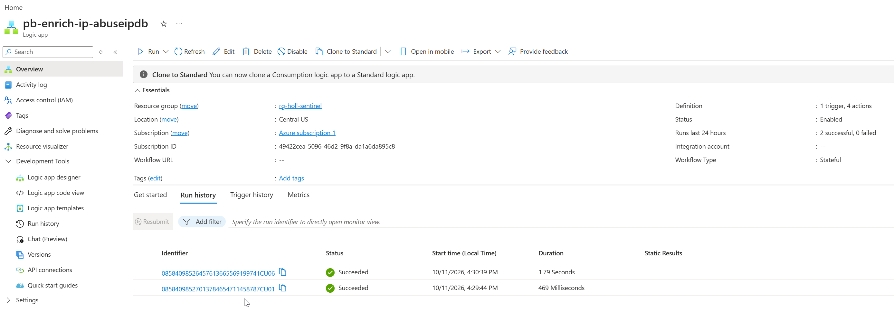
*Run history from troubleshooting #1: both runs show **Succeeded**, and the later one posted the blank comment. The status proved the workflow ran, not that its output was right.*

## Part 6 — Investigation Report & Teardown

### Investigation
The ten incidents were investigated as **one intrusion**: full write-up in [`report/incident-report.md`](report/incident-report.md). Every finding traces to a numbered query, and each is labeled confirmed, suspicious, or unresolved.

**Key results:**
- **Identity matched by SID, not name.** The account added to Domain Admins and the account Kali logged on with share SID `…-1107`. The display name (`Alex Herrnandez`) and logon name (`ahernandez`) differ, so a name match alone would have been unreliable.
- **Scope:** during the attack window, Kali (10.10.10.117) reached **DC01 and FS01 only**. Its second interface (.164) was checked and was silent. The Tier 0 logon attempt came from CLIENT01's own console, not from Kali.
- **Lateral movement proven to the creation level.** A privileged NTLM session (4672 on the same LogonId) was followed 66 ms later by `C:\Windows\rcnrtnEz.exe` and a service, `cvzA`. **Execution is unresolved**: there's no process-create event, and Defender's log isn't collected.
- **Negatives were validated before being trusted.** No log clearing, with full agent heartbeat during the window; no new accounts or tasks.
- **Coverage gaps found:** Defender Operational log not collected; 4697 service-install auditing off.

The evidence screenshots (P6-01 to P6-08) are in the report, next to the findings they support.

### Troubleshooting

| # | Problem | Cause | Fix |
|---|---|---|---|
| 1 | A 7-day check returned only the current day's events | The query had no time filter, so the portal's time picker (Last 24 hours) applied, hiding the 2026-10-10 group change | Set the time range inside each query (`where TimeGenerated between (...)`); the picker then reads "Set in query". |
| 2 | A SID comparison came back blank for logon events | 4624 stores the account SID in `TargetUserSid`; `TargetSid` holds the group's SID in 4728 | Used `TargetUserSid` for logons and `MemberSid` for the group change. |
| 3 | An exact-match query for `jdoe-adm` returned nothing, though an alert proved the event existed | Not identified | A broader `has "jdoe"` filter found it. The empty result was checked before being trusted. |
| 4 | The first scope check covered only one attacker IP | Kali is multi-homed (.117 and .164) | Re-ran scope across both IPs with `has_any`; .164 showed no activity. |

### Teardown
_Pending — before Azure credit ends (~Nov 8–9)._

---

## Repository Structure
```
├── README.md
├── screenshots/      # Evidence, numbered by part (e.g. P2-04-kerberoast-4769-both-siems.png)
├── kql/              # Analytics rules, one .kql per detection
│     ├── T1110-brute-force.kql
│     ├── T1558.003-kerberoasting-rc4.kql
│     ├── T1098-privileged-group-modification.kql
│     ├── T1078.002-tier0-logon-workstation.kql
│     ├── T1087-anomalous-ntlm-auth.kql
│     └── T1021.002-exe-dropped-windows-root.kql
├── playbooks/        # Logic App JSON exports (secrets replaced with placeholders)
│     └── pb-enrich-ip-abuseipdb.json
├── automation/       # Automation rule exports
│     └── ar-enrich-ip-abuseipdb.json
└── report/           # Incident report
      └── incident-report.md
```
