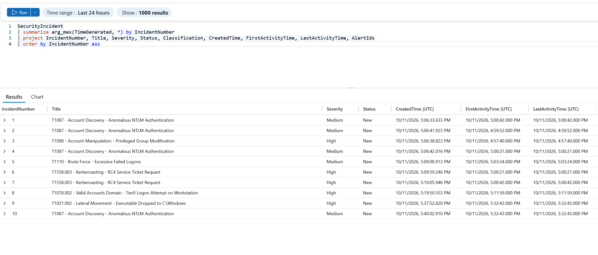
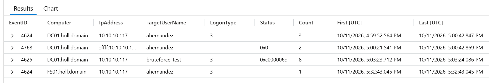
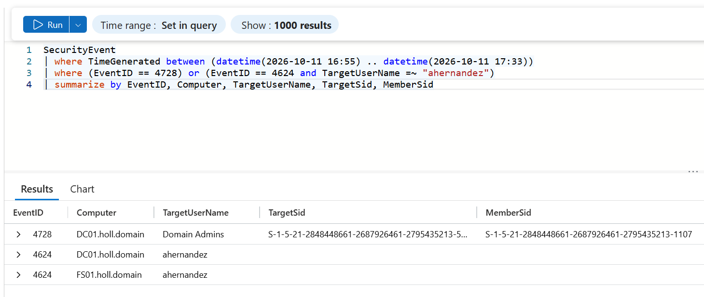
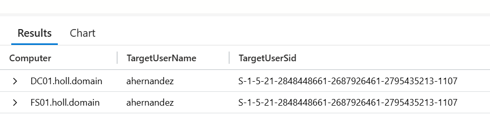
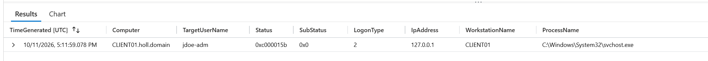
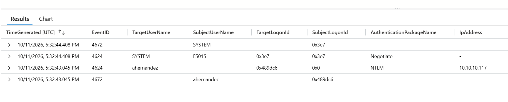
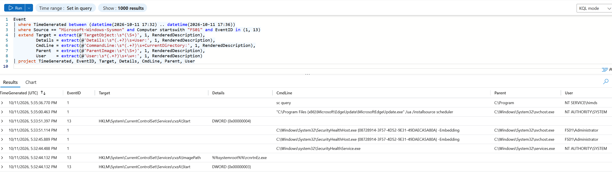
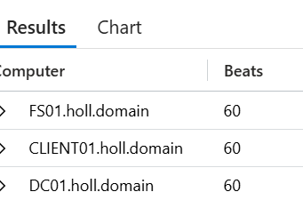

# Incident Report — Domain Account Compromise and Lateral Movement (holl.domain)

| | |
|---|---|
| **Date of activity** | 2026-10-11 |
| **Window (UTC)** | 16:57:40 – 17:32:43 (all times UTC, as stored in Sentinel; DC01 and the portal display UTC−5, CDT) |
| **Detected by** | Microsoft Sentinel, 6 custom scheduled analytics rules → 10 alerts → 10 incidents (#1–#10) |
| **Analyst** | Dakota Hollaway |
| **Severity** | **High** — a domain account with Domain Admins membership was used from an unmanaged host to authenticate to the DC and a file server, and a remote-execution binary was staged on that server |
| **Status** | Investigation complete; one question unresolved (§6) |

> **Context:** this is a controlled home-lab exercise. The attack chain was run deliberately from a Kali host to test detection. The report is written as it would be for a real incident: every finding is traced to a numbered query in [Appendix A](#appendix-a-queries), and each is labeled **Confirmed**, **Suspicious**, or **Unresolved**.

---

## 1. Summary

Between 16:57 and 17:33 UTC, the HR user account `ahernandez` was added to **Domain Admins**, then used from **10.10.10.117** (Kali, not a domain asset) to authenticate to **DC01** and **FS01**. From that address the attacker requested RC4-encrypted Kerberos service tickets (Kerberoasting), made 8 failed logon attempts against a test account, and, using the account's new admin rights, wrote `C:\Windows\rcnrtnEz.exe` to FS01 and registered a service (`cvzA`) to run it. That is the pattern of PsExec-style remote execution.

Separately, the Tier 0 account `jdoe-adm` attempted an interactive logon at **CLIENT01's own console** and was blocked by policy. It did not come from Kali.

**What reached what:** Kali authenticated to DC01 and FS01 only. It never logged on to CLIENT01 (Q4). **Whether `rcnrtnEz.exe` actually executed is unresolved**: it was created and configured as a service, but no process-creation event exists, and Defender's own log is not collected (§6).

All ten incidents belong to this one intrusion. Sentinel raised them as ten separate 1-alert incidents, with no grouping and no cross-rule correlation.

*Q1: the ten incidents, each created separately, between 17:06 and 17:40 UTC.*

---

## 2. Scope

| Asset | Role | Involvement | Basis |
|---|---|---|---|
| 10.10.10.117 | Attacker host (Kali, multi-homed: also 10.10.10.164) | Source of all remote activity | Q3b; .164 showed **no** activity in the window |
| DC01 (10.10.10.10) | Domain controller | Target: group change, NTLM logons, TGT/TGS requests, failed logons | Q3b, Q6b |
| FS01 (10.10.10.20) | File server | Target: privileged network logon, binary drop, service registration | Q3b, Q8, Q8b, Q12 |
| CLIENT01 | Workstation | Local Tier 0 logon attempt only; **no logons from Kali** | Q4, Q7b |
| `ahernandez` (SID `…-1107`) | HR user, made Domain Admin | Compromised account used by the attacker | Q10b, Q10c |
| `jdoe-adm` | Tier 0 admin | Blocked interactive logon at CLIENT01 | Q7b |
| `bruteforce_test` | Test account | Target of 8 failed logons | Q3b |
| `Administrator` | Built-in domain admin | Performed the Domain Admins addition | Q6b |

*Q3b: everything either Kali address did during the window. Only .117 appears, and only DC01 and FS01 were reached.*

**Identity:** the account added to Domain Admins (`MemberSid …-2795435213-1107`) and the account Kali logged on with at DC01 and FS01 (`TargetUserSid …-2795435213-1107`) are the **same SID** (Q10b, Q10c). This is matched by SID, not by name. The display name in the group-change event (`CN=Alex Herrnandez`) is spelled differently from the logon name (`ahernandez`), so a name match alone would have been unreliable.

*Q10b: the group change. `MemberSid` ends in `-1107`; `TargetSid` is the Domain Admins group itself.*

*Q10c: Kali's logons as `ahernandez` on DC01 and FS01 carry the same SID, `-1107`.*

---

## 3. Timeline (UTC)

| # | Time | Host | Event | What happened | Alert / Incident | Query |
|---|---|---|---|---|---|---|
| 1 | 16:57:40.039 | DC01 | 4728 | `Administrator` added `ahernandez` (SID …-1107) to **Domain Admins** | T1098 / #3 | Q6b, Q10b |
| 2 | 16:59:52.564 | DC01 | 4624 (type 3, NTLM) | `ahernandez` network logon from 10.10.10.117 | T1087 / #2 | Q3b |
| 3 | 17:00:21.5 | DC01 | 4624, 4768, 4769 (RC4) | Logon + TGT + RC4 service ticket requested by `ahernandez` from Kali | T1087 / #4, T1558.003 / #6 | Q3b, Q2 |
| 4 | 17:00:42.8 | DC01 | 4624, 4768, 4769 (RC4) | Repeat of #3 | T1087 / #1, T1558.003 / #7 | Q3b, Q2 |
| 5 | 17:03:23.712 – 17:03:24.086 | DC01 | 4625 ×8 (0xC000006D) | 8 failed network logons to `bruteforce_test` from Kali in under 1 s | T1110 / #5 | Q3b |
| 6 | 17:11:59.078 | CLIENT01 | 4625 (0xC000015B, type 2) | `jdoe-adm` interactive logon at the local console (127.0.0.1) **denied: logon type not granted** | T1078.002 / #8 | Q7b |
| 7 | 17:32:43.045 | FS01 | 4624 (type 3, NTLM) + 4672 | `ahernandez` network logon from Kali (LogonId `0x489dc6`), **with special privileges** on the same LogonId | T1087 / #10 | Q3b, Q12 |
| 8 | 17:32:43.111 | FS01 | Sysmon 11 | `System` (PID 4) created `C:\Windows\rcnrtnEz.exe` | T1021.002 / #9 | Q8 |
| 9 | 17:32:44.132 | FS01 | Sysmon 13 ×2 | `services.exe` registered service **cvzA**: `ImagePath = %systemroot%\rcnrtnEz.exe`, `Start = 3` (manual) | — | Q8b |
| 10 | 17:33:51.397 | FS01 | Sysmon 13 | `cvzA\Start` set to **4 (disabled)** | — | Q8b |
| 11 | 17:33:51.495 | FS01 | Sysmon 2 | **MsMpEng.exe** (Defender) changed the file-creation time of `rcnrtnEz.exe` | — | Q8 |

---

## 4. Findings

**F1: The account was elevated to Domain Admins before it was used. Confirmed.**
4728 at 16:57:40, performed by `Administrator` (Q6b). The same change appears on 2026-10-10 at 18:29:31 from the earlier test run (Q6b). In a real incident, *how* `Administrator` came to make this change would be the first escalation question: either that account was compromised, or someone with access to it acted for the attacker. Here it was the staged privilege-creep step.

**F2: Kerberoasting from Kali. Confirmed (request); unresolved (cracking).**
Two TGT requests by `ahernandez` from Kali (Q3b), each followed by an RC4 (0x17) service-ticket request that fired T1558.003 (alerts #6, #7; Q2). The tickets are encrypted with the *target service account's* password, which is what an attacker cracks offline. This proves tickets were *requested* with weak encryption. Which service account was targeted is in the alert's 4769 fields and isn't extracted here. Whether they were cracked offline leaves no trace on the domain and can't be determined from these logs.

**F3: Brute force against a test account. Confirmed (attempt); failed.**
8 × 4625 with 0xC000006D (bad user name or password) in 374 ms from Kali (Q3b). No successful logon for `bruteforce_test` followed in the window (Q4: 0 successes).

**F4: Tier 0 logon attempt at a workstation. Confirmed (attempt); blocked by policy.**
`jdoe-adm` tried an **interactive** logon at CLIENT01's console and was refused with 0xC000015B, meaning the account isn't allowed that logon type there (Q7b). The tiering control worked. **It's a local action, not from Kali.** It shows someone at CLIENT01 attempting to use a Tier 0 credential, which is the exposure the control exists to prevent. The record shows the account's involvement only; I don't attribute it to a person.

*Q7b: logon type 2 (interactive), source 127.0.0.1, status 0xC000015B. A local attempt at CLIENT01, not a network logon from Kali.*

**F5: Privileged lateral movement to FS01. Confirmed through creation; execution unresolved.**
- **Privileged session, confirmed:** NTLM logon from Kali as `ahernandez` with a 4672 on the same LogonId `0x489dc6` (Q12). The Domain Admins membership from F1 was in use on FS01.
- **Binary staged, confirmed (creation):** `C:\Windows\rcnrtnEz.exe` written by `System` 66 ms after the logon (Q8). That timing and the random name fit remote-exec tooling writing through the admin share.
- **Service configured, confirmed:** service `cvzA` pointing at the binary, demand-start (Q8b).
- **Execution not observed, unresolved:** there's no Sysmon 1 (process create) for `rcnrtnEz.exe` (Q8b). See §6.
- **Persistence, not supported:** `Start` was switched to 4 (disabled) 67 s later, which fits the tool removing its service, not a lasting foothold. No other persistence was found (§5).

*Q12: Kali's NTLM logon as `ahernandez` (LogonId `0x489dc6`) and the 4672 "special privileges" event on the same LogonId.*

*Q8b: service `cvzA` registered with ImagePath `%systemroot%\rcnrtnEz.exe` (Start = 3), then set to Start = 4 a minute later. The later `sc query` came from the Arc agent (`NT SERVICE\himds`).*

**F6: Detection coverage worked; triage didn't scale. Observation.**
All six rules fired, producing 10 alerts and 10 incidents (Q1, Q2). Eight of the ten share either `ahernandez` or DC01, yet each became its own incident. An analyst would see ten tickets for one intrusion.

---

## 5. What was checked and not found

Negatives are only reported once the check behind them was shown to work.

| Check | Result | Why the empty result is trustworthy |
|---|---|---|
| Log clearing (1102, 104), 7 days | None (Q5) | All three agents had 60/60 heartbeats from 16:45 to 17:45 (Q9b), so there was no collection gap |
| New accounts (4720), scheduled tasks (4698), other group adds (4732, 4756), 7 days | None (Q6b) | The same query returned the two known 4728 events |
| Kali logons to CLIENT01 | None (Q4) | The same query returned Kali's DC01 and FS01 logons |
| Activity from Kali's second IP (.164) | None in window (Q3b) | Same query returned all .117 activity |
| Service-install auditing (4697) | **Not evidence of absence**: this policy isn't enabled, so the event can't appear | Recorded as a coverage gap |
| Defender detections | **Not collected**: no Defender events in the Event table (Q13), while Sysmon in the same table and window returned rows (Q8) | Recorded as a coverage gap |

*Q9b: 60 heartbeats per host from 16:45 to 17:45 UTC, one a minute with no gaps. This is what makes the empty log-clearing result trustworthy.*

**Explained and dispositioned as benign:**
- `sc query` at 17:35:36 on FS01, run by `NT SERVICE\himds` (Azure Arc agent) (Q8b).
- `SecurityHealthHost.exe` under `FS01\Administrator`: the console session (Q8b).
- 10.10.10.186 → reports `WorkstationName = CLIENT01` (Q11). Self-reported, so labeled *likely* CLIENT01's DHCP address.
- 2026-10-10 22:48 4738/4724 on `ahernandez`: the logon-name correction recorded in Part 2.

---

## 6. Open question

**Did `rcnrtnEz.exe` execute?** There are two explanations, and the evidence doesn't separate them:
1. **Defender blocked or quarantined it.** Supported by MsMpEng touching the file 68 s after creation, and by Part 2's run 1, where Defender killed the remote shell. A prior observation from the earlier Splunk project in the same lab (not evidence from this run) also fits: there, Defender on FS01 blocked the same Impacket execution and left only the drop and the service. **One unknown weakens this:** Defender's real-time protection state on FS01 wasn't recorded for this run, and it had been turned off for Part 2's run 3.
2. **It ran and Sysmon didn't log it.** Less likely, since Sysmon logged other process creations on FS01 in the same minutes (Q8b), but not ruled out.

**What would settle it:** FS01 → Windows Security → Protection history, or the `Microsoft-Windows-Windows Defender/Operational` log (events 1116/1117) around 17:33 UTC. Until then, F5 stands at **creation**, not execution.

---

## 7. Recommendations

**Contain (if this were real):**
1. Remove `ahernandez` from Domain Admins, reset its password, and investigate how `Administrator` came to add it. Reset the password of the Kerberoasted service account, because its ticket may be cracked offline.
2. Isolate 10.10.10.117 at the network; it's not a domain asset.
3. On FS01, delete service `cvzA` if it still exists, and preserve and hash `rcnrtnEz.exe` (or retrieve it from quarantine) for triage.

**Close the coverage gaps found here:**
4. Collect `Microsoft-Windows-Windows Defender/Operational` in the Sysmon DCR so AV actions answer questions like §6.
5. Enable **Audit Security System Extension** (4697), or collect System 7045, so service installs are visible without relying on Sysmon registry events.

**Reduce the attack surface:**
6. Enforce AES-only Kerberos for service accounts, to remove RC4 tickets and make Kerberoasting cracking much harder.
7. Restrict NTLM. Every Kali logon here was NTLM in a domain that should be Kerberos-first.

**Fix the triage problem (F6):**
8. Enable **alert grouping** on T1087 and T1558.003 (group by matching Account and IP).
9. Widen rule lookbacks (for example, run every 5 min, look back 1 h) so an agent outage doesn't push events outside the window (Part 4 finding).

---

## Appendix A: Queries

All queries ran in Microsoft Sentinel Logs (workspace `law-holl-sentinel`).

| # | Purpose | Key result |
|---|---|---|
| Q1 | Incident inventory (`SecurityIncident`, latest per number) | 10 incidents, all New |
| Q2 | Alert inventory with entities (`SecurityAlert`, ASI Scheduled Alerts) | 10 alerts across 6 rules |
| Q3b | All events from 10.10.10.117 / .164, 16:00–18:00 | .117 → DC01 and FS01; .164 none |
| Q4 | 4624/4625 from Kali, by host and account | DC01 3 ok + 8 fail; FS01 1 ok; CLIENT01 none |
| Q5 | 1102/104, 7 days | None |
| Q6b | 4698/4697/4720/4728/4732/4756, 7 days | Two 4728 (10/10 and 10/11) only |
| Q7b | `jdoe-adm` 4625 17:00–17:20 | CLIENT01, type 2, 127.0.0.1, 0xC000015B |
| Q8 | Sysmon on FS01, 17:32–17:36 | File create, registry sets, MsMpEng touch |
| Q8b | Sysmon 1/13 fields extracted | `cvzA` ImagePath and Start values; `sc query` by himds |
| Q9b | Heartbeat 16:45–17:45 | 60/60/60 |
| Q10b | 4728 MemberSid | …-1107 |
| Q10c | 4624 TargetUserSid for `ahernandez` | …-1107 on DC01 and FS01 |
| Q11 | Identity of 10.10.10.186 | WorkstationName CLIENT01 |
| Q12 | 4624/4672 on FS01 at 17:32:43 | 4672 on LogonId 0x489dc6 |
| Q13 | Defender events, 17:30–17:40 | None (not collected) |

*Note:* the first version of the `jdoe-adm` query (exact match, 17:10–17:14) returned nothing even though the event exists. A broader `has "jdoe"` filter (Q7b) found it. The cause wasn't identified; it's a reminder to validate empty results.
